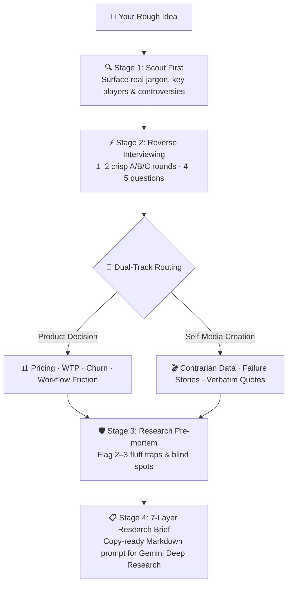

# 🧭 Deep Research Scoper

**English** | [简体中文](README.zh-CN.md)

> **Stop getting generic, bloated Deep Research reports.**  
> A pre-flight scoping and prompt calibration skill for **Gemini Deep Research** (and other deep research agents), engineered for **Product Decisions**, **Market & Pain-Point Analysis**, and **Self-Media Content Creation**.

`🎯 Gemini Deep Research` · `🧩 Dual-Track: Product & Self-Media` · `⚡ 1–2 Min Pre-Flight Scoping` · `📄 MIT License`

---

## 💡 Philosophy

**Treat Deep Research as an outsourced researcher, not a chatbot.**  
Every Deep Research run consumes time and quota. Spending **1–2 minutes on Pre-flight Scoping** before clicking *"Start Research"* is the highest-leverage way to eliminate surface-level 101 fluff.

**Interrogate first, write second.**  
This skill scouts domain jargon first, grills you with 1–2 crisp multiple-choice rounds, runs a skeptical Pre-mortem check, and outputs a zero-placeholder **7-Layer Research Brief** ready to paste straight into Gemini Deep Research.

---

## 🎯 Why This Skill?

When you drop a vague idea into Gemini Deep Research, its wide cross-lingual search often mixes vendor PR, SEO content farms, and real practitioner complaints into a long report that unlocks zero action.

| Pain Point | How Deep Research Scoper Solves It |
| --- | --- |
| 🌊 **Breadth Overload** | Locks in **Anti-Scope (Strict Exclusions)** and **Source Downranking** to strip out advertorials, press releases, and 101 tutorials. |
| 🔀 **Mixed Objectives** | Separates **Product Decisions** (pricing, WTP, unit economics, churn) from **Self-Media Creation** (contrarian data, failure stories, verbatim quotes). |
| ⏳ **Interrogation Fatigue** | Limits questioning to **1–2 rounds max** using fast `A/B/C` choices so you can answer in 30 seconds (e.g., `1A, 2B, 3C`). |
| 🕳️ **Hidden Blind Spots** | Runs a **Research Pre-mortem** before generating the prompt to flag 2–3 likely fluff traps and bake guardrails directly into the brief. |

---

## 🔄 How It Works (4-Stage Pipeline)



### 📋 The 7-Layer Research Brief Framework

| Layer | Purpose | Anti-Generic Example |
| --- | --- | --- |
| **1. 🎯 Decision Goal & Audience** | Locks in report depth and skips 101 basics | *"Help a 3-person SaaS team decide whether to adopt API X in 6 months; reader knows backend dev, not HIPAA."* |
| **2. 🔑 Jargon & Keyword Anchors** | Sharpens retrieval accuracy with exact terms | *"Include exact terms: RAGAS, hybrid reranking, P99 latency, token caching."* |
| **3. 🚧 Scope & Anti-Scope** | Exclusions cut fluff more than inclusions | *"2025–2026 only; China & SEA markets; **exclude** conceptual hype and traditional outsourcing agencies."* |
| **4. 📡 Source Priority & Downranking** | Separates frontline signal from SEO noise | *"Prioritize GitHub Issues, Reddit practitioner threads, earnings calls; **downrank** vendor PR and SEO listicles."* |
| **5. 🧵 Core Research Tracks** | Enforces structured depth (4–6 tracks × 2–3 sub-questions) | *"Track 3: Real cancellation reasons & hidden migration costs."* |
| **6. ⚖️ Evidence, Seed & Conflict Rules** | Prevents hallucination and hand-waving | *"Label missing metrics 'No public data found'; display conflicting figures side by side with methodology notes."* |
| **7. 📐 Deliverable & Comparison Axes** | Forces concrete tables and actionable outputs | *"Mandatory table: `[Pricing | Hidden Costs | Failure Modes | Best-Fit Boundary]` + Go/No-Go checklist."* |

---

## ✅ Good vs. ❌ Bad Research Questions

| Track | ❌ Bad (Too Vague) | ✅ Good (Calibrated by Scoper) |
| --- | --- | --- |
| **Product / Market** | *"Analyze the AI note-taking app market."* | *"Compare pricing, retention friction, and local-first privacy tradeoffs across Notion AI, Obsidian plugins, and Heptabase in 2025–2026 for solo knowledge workers willing to pay $10–$20/month, using Reddit and GitHub Issues to catalog top cancellation reasons."* |
| **Self-Media / Content** | *"Give me video ideas about indie hackers."* | *"Find 5 counter-intuitive failure post-mortems from solo SaaS founders in 2025–2026 who reached $5K+ MRR and still shut down or pivoted, including exact burn/CAC numbers, platform dependency traps, and verbatim quotes from X, Indie Hackers, and Reddit."* |

---

## 🚀 Installation & Usage

### ⚡ Method 1: One-Sentence Agent Auto-Install (Recommended)

Paste this single sentence into your AI agent (Gemini, Claude Code, Codex, Cursor, etc.):

```text
Install the deep-research-scoper skill from https://github.com/Turnmuse/deep-research-scoper into my agent skills library.
```

### 🛠️ Method 2: Manual Install

1. Clone this repository into your agent's local skills directory:
   ```bash
   git clone https://github.com/Turnmuse/deep-research-scoper.git
   ```
2. Or upload `SKILL.md` directly via your platform's **Skills Manager**.

### 💬 Trigger Examples

Start a regular chat before opening Deep Research:

- *"Help me scope a Deep Research prompt on AI coding agent pricing models."*
- *"Use deep-research-scoper: I want to research why solo creators burn out on YouTube Shorts."*
- *"Calibrate a research brief before I run Gemini Deep Research on local-first CRM tools."*

---

## 📚 Walkthrough Examples

See full end-to-end conversations — from a 1-sentence rough idea through Scouting, Reverse Interviewing, Pre-mortem, and the final copy-ready 7-Layer Research Brief:

- 🇺🇸 **English Walkthroughs** (Product Decision + Self-Media Creation): [`examples/example-en.md`](examples/example-en.md)
- 🇨🇳 **Chinese Walkthroughs** (产品决策调研 + 自媒体爆款选题): [`examples/example-zh.md`](examples/example-zh.md)

<details>
<summary><b>👀 Quick Preview: 30-Second Calibration Session</b></summary>

1. **You**: *"I want to research AI coding assistants to see if there's room for a niche developer tool."*
2. **Scoper (Stage 1 + 2)**: Surfaces real terms (`context rot`, `agentic loop cost`, `MCP adoption`, `Cursor vs. Windsurf vs. Claude Code`) and asks 4 quick `A/B/C` questions.
3. **You**: `1A (Product), 2B (2025-2026 Global solo/small teams), 3A (Exclude vendor PR & generic benchmarks), 4A (Reddit + GitHub Issues + HN)`
4. **Scoper (Stage 3 + 4)**: Flags 2 pre-mortem traps (*benchmark gaming vs. real repo friction*, *hidden API token burn*) and outputs a ready-to-paste **7-Layer Research Brief**.

</details>

---

## 📁 Project Structure

```text
deep-research-scoper/
├── SKILL.md                 # Core Agent Skill definition (YAML frontmatter + 4-stage workflow)
├── README.md                # English documentation (primary)
├── README.zh-CN.md          # Simplified Chinese documentation
├── LICENSE                  # MIT License
└── examples/
    ├── example-en.md        # Complete English walkthroughs (Product & Self-Media)
    └── example-zh.md        # Complete Chinese walkthroughs (Product & Self-Media)
```

---

## 📄 License

MIT License — see [LICENSE](LICENSE) for details. Feel free to fork and tailor to your own research workflow.
