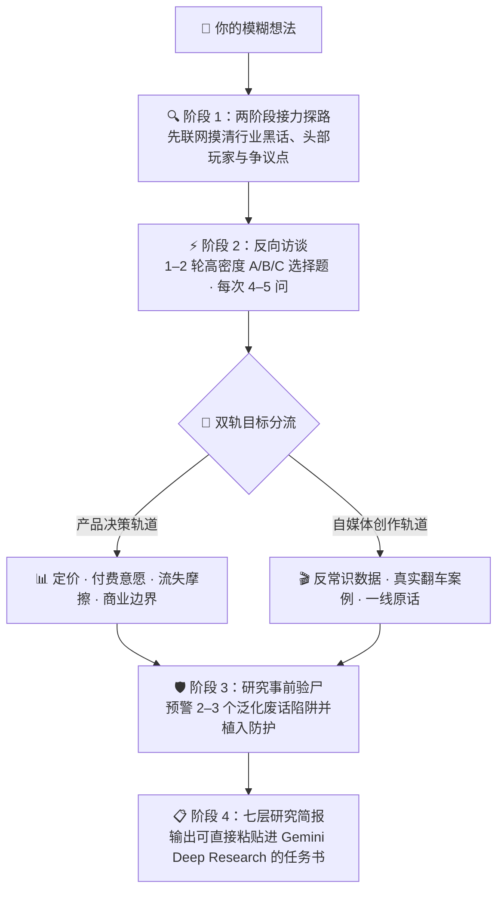

# 🧭 Deep Research Scoper（深度研究前置校准器）

[English](README.md) | **简体中文**

> **让每一次 Deep Research 都不再跑偏、不再泛化。**  
> 专为 **Gemini Deep Research**（兼顾其他深度研究 Agent）打造的前置需求校准 Skill，聚焦**产品决策**、**市场/痛点/解决方案分析**以及**自媒体内容创作与商业化赛道调研**。

`🎯 Gemini Deep Research` · `🧩 产品 + 自媒体双轨校准` · `⚡ 1–2 分钟前置定焦` · `📄 MIT License`

---

## 💡 核心理念

**把 Deep Research 当成“外包研究员”，而不是“聊天机器人”。**  
单次深度研究耗时长、额度贵。在点击“开始研究”之前，花 **1–2 分钟做一次前置需求颗粒度校准（Pre-flight Scoping）**，是杜绝泛化科普废话性价比最高的做法。

**先反问，再动笔（Interrogate first, write second）。**  
本 Skill 会先快速联网摸清行业黑话，再用 1–2 轮高密度选择题完成反向访谈，接着做一次挑剔视角的事前验尸，最终输出一份可直接复制进 Gemini Deep Research 运行的**零占位符《七层研究简报》**。

---

## 🎯 为什么需要这个 Skill？

如果直接把模糊想法丢给 Gemini Deep Research，它极广的跨语种检索面很容易把厂商公关稿、SEO 水文和一线真实吐槽混在一起，输出一篇看着很长但完全无法落地的综述。

| 常见痛点 | Deep Research Scoper 的解法 |
| --- | --- |
| 🌊 **检索广度过载** | 强制写入 **排除项（Anti-Scope）** 与 **信源降权规则**，开跑前直接砍掉软文、通稿和 101 科普。 |
| 🔀 **调研目标混杂** | 严格区分 **产品决策轨道**（定价、付费意愿、流失原因、单位经济）与 **自媒体轨道**（反常识数据、翻车故事、一线原话）。 |
| ⏳ **提问轮次消耗耐心** | 严格限制在 **1–2 轮内**，使用带 `A/B/C` 选项的快问快答，30 秒回复（如 `1A, 2B, 3C`）即可完成。 |
| 🕳️ **隐性视角盲区** | 生成前先执行 **研究事前验尸（Pre-mortem）**，提前预警 2–3 个最容易产废话的坑并自动植入防护规则。 |

---

## 🔄 核心工作流（4 阶段流水线）



### 📋 《七层研究简报》核心结构

| 层级 | 为什么必须写 | 反泛化示例 |
| --- | --- | --- |
| **1. 🎯 决策目标与受众** | 决定报告深度与取舍，避免写成科普文 | *“帮助 3 人 SaaS 团队决定未来 6 个月是否接入某 API，受众懂后端但不懂医疗合规。”* |
| **2. 🔑 行话与关键词锚点** | 极大提升 Deep Research 底层检索精准度 | *“锁定术语：RAGAS、Hybrid Reranking、P99 延迟、Token Caching。”* |
| **3. 🚧 范围与排除项（Anti-Scope）** | **排除项比包含项更重要**，直接砍掉水字数 | *“限定 2025–2026 年、中国与东南亚市场；**排除**纯概念炒作与传统外包商。”* |
| **4. 📡 信源优先级与降权** | 防止抓取一堆营销号、公关通稿和 SEO 垃圾文 | *“优先引用 GitHub Issue、Reddit 一线实测、财报；**降权**软文与无出处自媒体。”* |
| **5. 🧵 核心研究脉络（4–6 条）** | 强制按结构化子问题深挖（每条含 2–3 个子问题） | *“脉络 3：真实付费流失原因与隐性迁移成本。”* |
| **6. ⚖️ 证据、种子资料与冲突规则** | 防止查不到数据时强行编造或和稀泥 | *“缺失数据标注‘未找到公开数据’；冲突数据并列呈现并说明统计口径差异。”* |
| **7. 📐 交付结构与对比轴** | 逼迫 AI 按你的框架填空，而不是自由发挥 | *“必含对比表：`[定价 | 隐性成本 | 真实翻车点 | 适用边界]` + 可执行清单。”* |

---

## ✅ 好问题 vs. ❌ 差问题对比

| 调研轨道 | ❌ 差问题（过于宽泛） | ✅ 好问题（经本 Skill 校准后） |
| --- | --- | --- |
| **产品 / 市场调研** | *“分析一下 AI 笔记软件市场。”* | *“对比 2025–2026 年 Notion AI、Obsidian 插件生态与 Heptabase 在个人知识工作者（付费意愿 $10–$20/月）中的定价、留存摩擦与本地隐私权衡，重点基于 Reddit 和 GitHub Issues 梳理核心退订原因。”* |
| **自媒体 / 选题创作** | *“给我几个关于独立开发者的视频选题。”* | *“检索 2025–2026 年 5 个曾做到月收入 $5K+ 但最终关停或被迫转型的独立 SaaS 反常识翻车复盘，需包含具体获客成本/烧钱数据、平台依赖陷阱，以及来自 X、Indie Hackers 和 Reddit 的一线原话引用。”* |

---

## 🚀 安装与使用

### ⚡ 方式一：一句话让 Agent 自动安装（推荐）

直接把下面这句话发给你的 AI Agent（Gemini、Claude Code、Codex、Cursor 等）：

```text
帮我从 https://github.com/Turnmuse/deep-research-scoper 自动安装 deep-research-scoper 这个 Skill 到我的 Agent 技能库。
```

### 🛠️ 方式二：手动安装

1. 克隆本仓库到你的 Agent 本地 Skills 目录：
   ```bash
   git clone https://github.com/Turnmuse/deep-research-scoper.git
   ```
2. 或者在平台的 **Skills Manager** 中直接上传 `SKILL.md`。

### 💬 触发方式示例

在正式打开 Deep Research 之前，在普通对话窗口中直接触发：

- *“帮我校准一个 Deep Research 提示词：我想调研 AI 编程助手的商业化定价模式。”*
- *“用 deep-research-scoper，我想做一期关于个人创作者为什么在短视频赛道容易枯竭的深度选题。”*
- *“跑 Gemini Deep Research 之前先帮我理一下研究简报：本地优先（Local-first）CRM 工具的真实痛点。”*

---

## 📚 完整实战案例（Examples）

查看从“一句话模糊想法”到“完整《七层研究简报》”的端到端演示：

- 🇺🇸 **英文完整案例**（Product Decision + Self-Media Creation）：[`examples/example-en.md`](examples/example-en.md)
- 🇨🇳 **中文完整案例**（产品决策调研 + 自媒体爆款选题）：[`examples/example-zh.md`](examples/example-zh.md)

<details>
<summary><b>👀 快速预览：30 秒完成一次前置校准</b></summary>

1. **你**：*“我想调研一下 AI 编程助手，看看小团队切入垂直工具还有没有机会。”*
2. **Scoper（阶段 1 + 2）**：先探路抛出一线黑话（`上下文腐烂`、`Agentic Loop 隐性 Token 成本`、`MCP 生态`、`Cursor / Windsurf / Claude Code 留存摩擦`），并一次性给出 4 个 `A/B/C` 快选题。
3. **你**：`1A（产品决策）, 2B（2025-2026 全球个人与小团队）, 3A（剔除厂商通稿与跑分软文）, 4A（Reddit + GitHub Issues + HN）`
4. **Scoper（阶段 3 + 4）**：预警 2 个事前验尸陷阱（*刷榜跑分与真实大仓库体验脱节*、*订阅制下的隐性额度限流*），直接输出可一键复制的**《七层研究简报》**。

</details>

---

## 📁 目录结构

```text
deep-research-scoper/
├── SKILL.md                 # 核心 Agent Skill 指令定义（YAML Frontmatter + 四阶段工作流）
├── README.md                # 英文主说明文档
├── README.zh-CN.md          # 简体中文说明文档
├── LICENSE                  # MIT 开源协议
└── examples/
    ├── example-en.md        # 英文端到端实战案例（产品决策 + 自媒体创作）
    └── example-zh.md        # 中文端到端实战案例（产品决策 + 自媒体创作）
```

---

## 📄 开源协议

基于 MIT License 开源，详见 [LICENSE](LICENSE)。欢迎自由 Fork 并按你的研究工作流二次定制。
